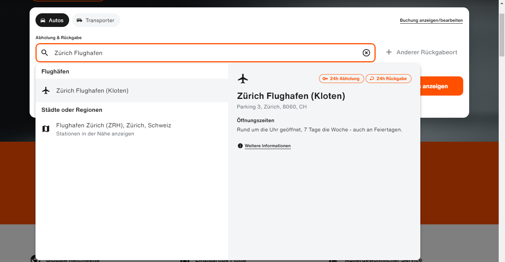
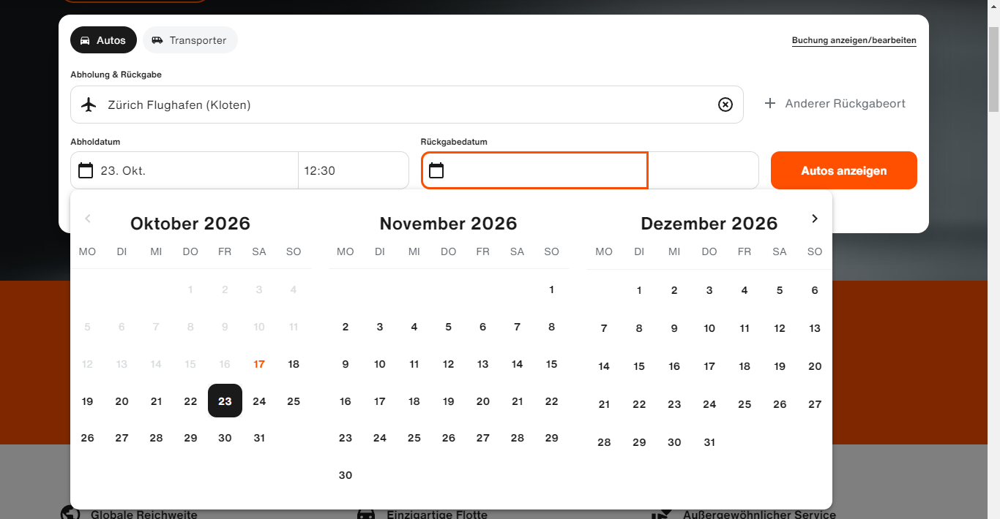
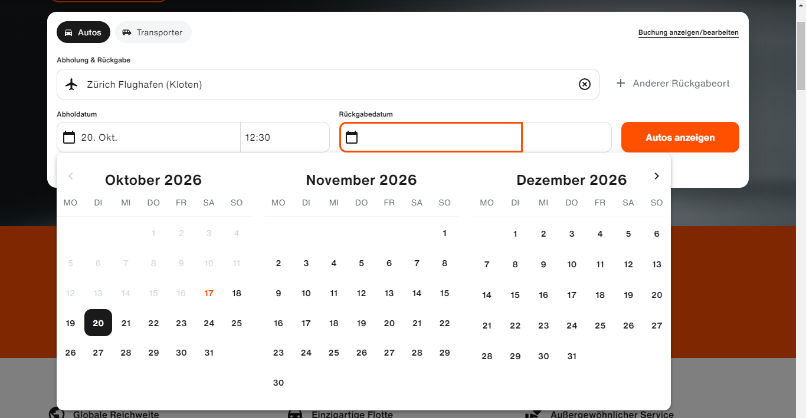
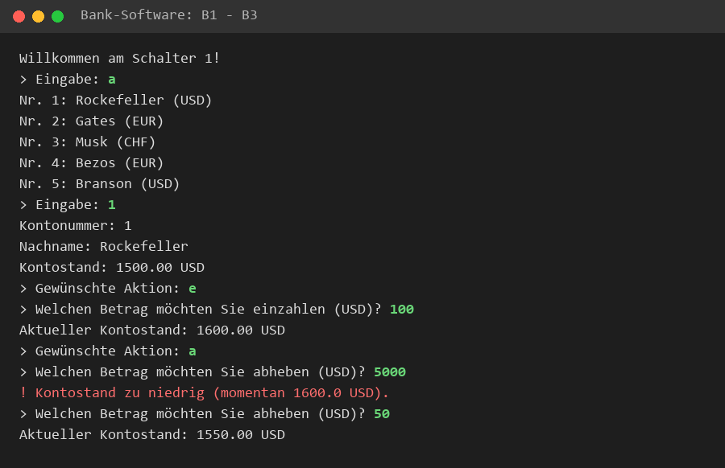
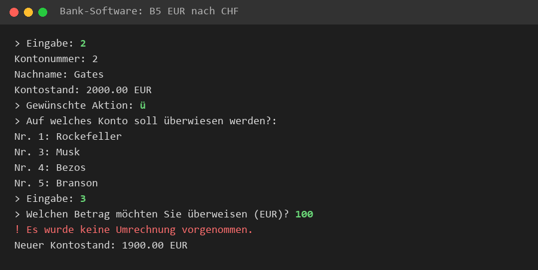
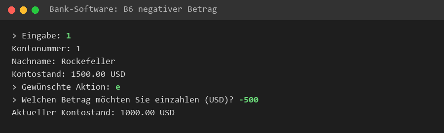
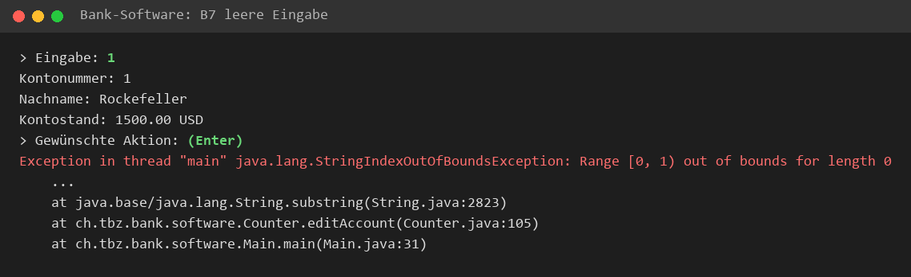
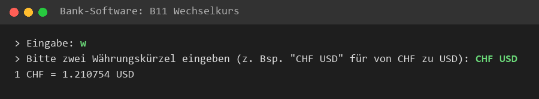

# KN02 – Lösungen

## Übung 1 – Rabattregeln Autohaus

Regeln: unter 15'000 CHF kein Rabatt, bis 20'000 CHF 5 %, unter 25'000 CHF 7 %, darüber 8.5 %.

### Abstrakte Testfälle

| ID | Eingabe (Kaufpreis P) | Erwarteter Rabatt |
|---|---|---|
| A1 | P < 15'000 | 0 % |
| A2 | 15'000 ≤ P ≤ 20'000 | 5 % |
| A3 | 20'000 < P < 25'000 | 7 % |
| A4 | P ≥ 25'000 | 8.5 % |
| A5 | P < 0 | Fehlermeldung (ungültiger Preis) |

### Konkrete Testfälle

| ID | Kaufpreis (CHF) | Erwarteter Rabatt | Erwarteter Endpreis (CHF) | Gehört zu |
|---|---|---|---|---|
| K1 | 10'000 | 0 % | 10'000.00 | A1 |
| K2 | 14'999.95 | 0 % | 14'999.95 | A1 (Grenze) |
| K3 | 15'000 | 5 % | 14'250.00 | A2 (Grenze) |
| K4 | 20'000 | 5 % | 19'000.00 | A2 (Grenze) |
| K5 | 20'000.05 | 7 % | 18'600.05 | A3 (Grenze) |
| K6 | 24'999.95 | 7 % | 23'249.95 | A3 (Grenze) |
| K7 | 25'000 | 8.5 % | 22'875.00 | A4 (Grenze) |
| K8 | 50'000 | 8.5 % | 45'750.00 | A4 |
| K9 | -100 | – | Fehlermeldung | A5 |

Die Grenzwerte sind wichtig, weil dort am meisten Fehler passieren (z.B. `<` statt `<=`).

---

## Übung 2 – Black-Box Tests Autovermietung

Webseite: [www.sixt.ch](https://www.sixt.ch)

| ID | Beschreibung | Erwartetes Resultat | Effektives Resultat | Status | Mögliche Ursache |
|---|---|---|---|---|---|
| 1 | Abholort "Zürich Flughafen", Abholung 20. Okt., Rückgabe 26. Okt. eingeben und "Autos anzeigen" klicken | Liste mit verfügbaren Autos und Preisen für diesen Zeitraum wird angezeigt | Ort wird vorgeschlagen, Daten werden übernommen. Die Ergebnisliste wurde im automatisierten Testbrowser mit "Access denied" blockiert | Offen | Bot-Schutz von sixt.ch, im normalen Browser manuell prüfen |
| 2 | Abholdatum 23. Okt. wählen, danach als Rückgabe den 20. Okt. anklicken | Rückgabe vor Abholung ist nicht möglich | Der 20. Okt. wird nicht als Rückgabe übernommen, sondern als neues Abholdatum gesetzt | OK | – |
| 3 | Auto auswählen und Zusatzoption "Kindersitz" hinzufügen | Gesamtpreis erhöht sich um den Preis des Kindersitzes | Noch nicht getestet | Offen | Braucht die Ergebnisliste (siehe Test 1) |
| 4 | Buchungsformular ohne E-Mail-Adresse absenden | Fehlermeldung "E-Mail ist ein Pflichtfeld", Buchung wird nicht ausgeführt | Noch nicht getestet | Offen | Braucht die Ergebnisliste (siehe Test 1) |
| 5 | Buchung mit gültigen Daten abschliessen | Bestätigungsseite mit Buchungsnummer und Bestätigungs-E-Mail | Nicht durchgeführt (echte Buchung) | Offen | Test nur auf Testumgebung möglich |

**Test 1 – Ort suchen und Daten eingeben**




**Test 2 – Abholung am 23. Okt. gewählt …**



**… Klick auf den 20. Okt. setzt ein neues Abholdatum statt einer Rückgabe vor der Abholung**



---

## Übung 3 – Bank-Software

Projekt: [bank-software/bank-software-mvn](bank-software/bank-software-mvn)

Starten:

```bash
cd bank-software/bank-software-mvn
mvn compile exec:java -Dexec.mainClass=ch.tbz.bank.software.Main
```

### Aufbau

| Klasse | Aufgabe |
|---|---|
| `Main` | Startet das Programm, erstellt 5 Konten und den Schalter |
| `Bank` | Verwaltet die Liste mit allen Konten (erstellen, löschen, suchen, anzeigen) |
| `Account` | Ein Konto mit Nummer, Nachname, Währung und Kontostand (einzahlen, abheben) |
| `Counter` | Der Bankschalter: Menü in der Konsole, liest Eingaben, überweist und rechnet Währungen um |
| `ExchangeRateOkhttp` | Holt den aktuellen Wechselkurs über eine Web-API (OkHttp + Gson) |

### Black-Box Testfälle (als Benutzer)

| ID | Beschreibung | Erwartetes Resultat | Effektives Resultat | Status | Mögliche Ursache |
|---|---|---|---|---|---|
| B1 | Im Hauptmenü `a` eingeben | Alle 5 Konten werden aufgelistet | Alle Konten werden angezeigt | OK | – |
| B2 | Konto `1` wählen, `e`, 100 einzahlen | Kontostand 1600.00 USD | 1600.00 USD | OK | – |
| B3 | Konto 1, `a`, 5000 abheben | Meldung "Kontostand zu niedrig", Kontostand bleibt gleich | Meldung erscheint | OK | – |
| B4 | Konto 1, `ü`, auf Konto 2 (EUR) 100 USD überweisen | Konto 1: -100 USD, Konto 2: +91 EUR | Konto 1: 1400 USD, Konto 2: 2091 EUR | OK | – |
| B5 | Konto 2 (EUR), `ü`, auf Konto 3 (CHF) überweisen | Betrag wird in CHF umgerechnet | "Es wurde keine Umrechnung vorgenommen" | Fehler | EUR→CHF fehlt in `convertCurrency` |
| B6 | Konto 1, `e`, -500 einzahlen | Fehlermeldung, negativer Betrag nicht erlaubt | Kontostand sinkt um 500 | Fehler | Keine Prüfung auf negative Beträge |
| B7 | Konto 1, bei "Gewünschte Aktion" nur Enter drücken | Meldung "Ungültige Eingabe" | Programm stürzt ab (StringIndexOutOfBoundsException) | Fehler | `substring(0,1)` auf leeren String |
| B8 | Hauptmenü `99` eingeben | Meldung "Konto nicht vorhanden" | Meldung erscheint | OK | – |
| B9 | Hauptmenü `e`, Name "Muster", Währung `GBP` | Konto wird mit USD erstellt, Hinweis erscheint | Hinweis erscheint, Konto mit USD | OK | – |
| B10 | Konto 1, `l`, `j` | Konto 1 wird gelöscht und ist nicht mehr in der Liste | Konto wird gelöscht | OK | – |
| B11 | Hauptmenü `w`, "CHF USD" | Aktueller Wechselkurs wird angezeigt | "1 CHF = 1.21 USD" | OK | – |

Ausgaben in der Konsole (grün = Eingabe des Benutzers):

**B1–B3:** Konten anzeigen, 100 einzahlen, zu viel abheben



**B5:** EUR → CHF überweisen, es wird nicht umgerechnet



**B6:** Negativer Betrag wird eingezahlt, Kontostand sinkt



**B7:** Leere Eingabe, Programm stürzt ab



**B11:** Wechselkurs abfragen



### Methoden für White-Box Testfälle

| Klasse | Methode | Was testen? |
|---|---|---|
| `Account` | `deposit(amount)` | Kontostand steigt um den Betrag |
| `Account` | `withdraw(amount)` | Gibt `true` zurück und zieht ab, wenn genug Geld da ist, sonst `false` |
| `Account` | Konstruktor | IDs werden fortlaufend vergeben |
| `Bank` | `createAccount(...)` | Konto ist danach in der Liste, `getNumberOfAccounts()` steigt |
| `Bank` | `getAccount(nr)` | Richtiges Konto oder `null`, wenn es nicht existiert |
| `Bank` | `deleteAccount(a)` | Konto ist nicht mehr in der Liste |
| `Counter` | `convertCurrency(...)` | Alle Währungspaare werden richtig umgerechnet |
| `Counter` | `transferAmount(...)` | Geld wird von einem Konto abgezogen und dem anderen gutgeschrieben |
| `ExchangeRateOkhttp` | `getExchangeRate(...)` | Mit gemockter API: richtiges Resultat bzw. 0.0 bei Fehler |

### Verbesserungen / Best Practices

- **Logik und Ausgabe trennen:** `Counter` liest Eingaben, rechnet und gibt aus. Dadurch ist er schwer testbar. Besser: eigene Klasse für Überweisung und Umrechnung, die nichts mit `Scanner` zu tun hat.
- **Eingaben prüfen:** negative Beträge und leere Eingaben abfangen.
- **Währungsumrechnung vollständig machen:** EUR→CHF, CHF→EUR und EUR→USD fehlen. Besser mit einer Tabelle oder `Map`.
- **API-Key nicht im Code:** Key in eine Umgebungsvariable oder Config-Datei auslagern.
- **Kein `double` für Geld:** `BigDecimal` verwenden, um Rundungsfehler zu vermeiden.
- **Exceptions sauber verwenden:** statt `catch (Exception e)` mit `instanceof` die konkreten Exceptions fangen. Tippfehler `AccountExeption` → `AccountException`.
- **Statischer Zähler `counter` in `Account`:** macht Tests voneinander abhängig. Besser die Bank vergibt die Nummern.
- **Unit-Tests hinzufügen** (JUnit) für `Account` und `Bank`.
