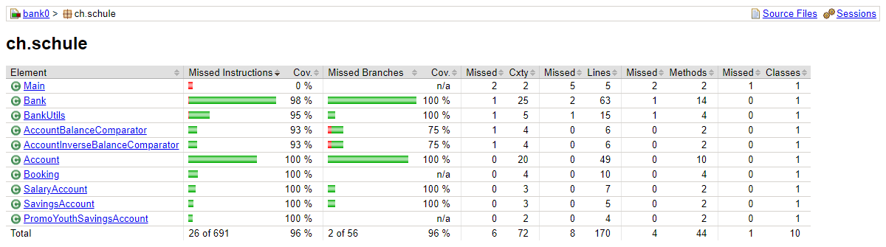

# KN03 – Lösungen

## Testlevels

### Aufgabe 1 – Testen in der Firma

- **Test Levels:** Unit-Tests schreiben wir selbst als Entwickler. Integrationstests laufen gegen eine Test-Datenbank. System- und Abnahmetests macht der Fachbereich bzw. der Kunde auf der Testumgebung.
- **Wann wird getestet:** Unit- und Integrationstests laufen bei jedem Push automatisch in der Pipeline. Systemtests vor jedem Release, Abnahmetests vor dem Go-Live.
- **QA-Team:** Kein grosses eigenes QA-Team. Ein Tester bzw. Product Owner prüft neue Features manuell.
- **Testing Life Cycle:** Anforderung → Testfälle definieren → entwickeln + Unit-Tests → Code Review → Pipeline (Build + Tests) → Test auf Testumgebung → Abnahme → Deployment auf Produktion.

### Aufgabe 2 – Begriffe einordnen

| Begriff | Bedeutung | Beispiele |
|---|---|---|
| **Testing approach** | *Wie* wir grundsätzlich testen (Sicht auf das System) | White-Box, Black-Box, Grey-Box, manuell vs. automatisiert |
| **Testing levels** | *Auf welcher Stufe* getestet wird | Unit, Component, Integration, System, Acceptance |
| **Testing types, techniques and tactics** | *Was genau* und *mit welcher Technik* getestet wird | funktional, Performance, Last, Security, Usability, Regression, Grenzwertanalyse, Äquivalenzklassen |

**Abhängigkeiten:** Der *Approach* bestimmt die Sicht. Jedes *Level* nutzt einen Approach, z.B. Unit = White-Box und Acceptance = Black-Box. Auf jedem Level werden passende *Types/Techniken* angewendet. Performance-Tests gehören z.B. meist zum Systemtest.

## Unit Testing

### Aufgabe 1 – Simpler Rechner

Projekt: [calculator](calculator)

- `src/main/java/.../Calculator.java` – add, subtract, multiply, divide
- `src/test/java/.../CalculatorTest.java` – 14 Tests mit `@BeforeEach`, `@Test`, `@DisplayName`, `@ParameterizedTest`, `assertThrows`

Ausführen:
1. IntelliJ: Rechtsklick auf `CalculatorTest` → *Run*
2. Kommandozeile: `cd calculator` und `mvn test`

```
$ mvn test
Running ch.tbz.calculator.CalculatorTest
Tests run: 14, Failures: 0, Errors: 0, Skipped: 0 - ch.tbz.calculator.CalculatorTest
Tests run: 14, Failures: 0, Errors: 0, Skipped: 0
BUILD SUCCESS
```

### Aufgabe 2 – JUnit Zusammenfassung

Siehe [JUNIT_ZUSAMMENFASSUNG.md](JUNIT_ZUSAMMENFASSUNG.md)

### Aufgabe 3 – Banken Simulation

Siehe [BANK_DOKU.md](BANK_DOKU.md)

### Aufgabe 4 – Unit-Tests Bank

Projekt: [bank/02_bank-vorgabe](bank/02_bank-vorgabe)

```bash
cd bank/02_bank-vorgabe
mvn test
```

- 40 Tests, alle grün
- Coverage-Report (JaCoCo): `target/site/jacoco/index.html`

```
$ mvn test
Running ch.schule.bank.junit5.AccountTests
Tests run: 9, Failures: 0, Errors: 0, Skipped: 0 - ch.schule.bank.junit5.AccountTests
Running ch.schule.bank.junit5.BankTests
Tests run: 14, Failures: 0, Errors: 0, Skipped: 0 - ch.schule.bank.junit5.BankTests
Running ch.schule.bank.junit5.BookingTests
Tests run: 5, Failures: 0, Errors: 0, Skipped: 0 - ch.schule.bank.junit5.BookingTests
Running ch.schule.bank.junit5.PromoYouthSavingsAccountTests
Tests run: 5, Failures: 0, Errors: 0, Skipped: 0 - ch.schule.bank.junit5.PromoYouthSavingsAccountTests
Running ch.schule.bank.junit5.SalaryAccountTests
Tests run: 4, Failures: 0, Errors: 0, Skipped: 0 - ch.schule.bank.junit5.SalaryAccountTests
Running ch.schule.bank.junit5.SavingsAccountTests
Tests run: 3, Failures: 0, Errors: 0, Skipped: 0 - ch.schule.bank.junit5.SavingsAccountTests
Tests run: 40, Failures: 0, Errors: 0, Skipped: 0
BUILD SUCCESS
```



| Klasse | Line Coverage |
|---|---|
| Account | 100 % |
| Bank | 97 % |
| Booking | 100 % |
| SavingsAccount | 100 % |
| SalaryAccount | 100 % |
| PromoYouthSavingsAccount | 100 % |
| BankUtils | 93 % |
| Comparators | 100 % |
| Main | 0 % (nur Startklasse) |

Bei `print()` wird `System.out` in einen `ByteArrayOutputStream` umgeleitet. So kann man prüfen, was gedruckt wurde.
