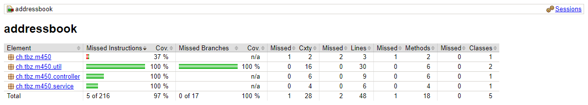

# KN04 – Schnittstellen / Mocking

Projekt: [addressbook](addressbook) (Spring Boot, Java 21)

```bash
cd addressbook
mvn test
```

- 25 Tests, alle grün
- Coverage-Report: `target/site/jacoco/index.html`

```
$ mvn test
Running ch.tbz.m450.AddressbookApplicationTest
Tests run: 1, Failures: 0, Errors: 0, Skipped: 0 - ch.tbz.m450.AddressbookApplicationTest
Running ch.tbz.m450.controller.AddressControllerTest
Tests run: 4, Failures: 0, Errors: 0, Skipped: 0 - ch.tbz.m450.controller.AddressControllerTest
Running ch.tbz.m450.repository.AddressTest
Tests run: 3, Failures: 0, Errors: 0, Skipped: 0 - ch.tbz.m450.repository.AddressTest
Running ch.tbz.m450.service.AddressServiceTest
Tests run: 6, Failures: 0, Errors: 0, Skipped: 0 - ch.tbz.m450.service.AddressServiceTest
Running ch.tbz.m450.util.AddressComparatorTest
Tests run: 11, Failures: 0, Errors: 0, Skipped: 0 - ch.tbz.m450.util.AddressComparatorTest
Tests run: 25, Failures: 0, Errors: 0, Skipped: 0
BUILD SUCCESS
```



## Aufgabe 1 – Tests für alle Klassen

| Testklasse | Was wird getestet | Technik |
|---|---|---|
| `AddressTest` | Adressen erstellen (Konstruktoren, Getter, Setter) | `@BeforeEach` |
| `AddressComparatorTest` | Sortierung nach Nachname → Vorname → Registrierungsdatum, `null`-Werte | `@BeforeEach` |
| `AddressServiceTest` | Service ohne echte Datenbank | `@Mock` für das `AddressRepository` (h2 wird weggemockt), `when(...).thenReturn(...)`, `verify(...)` |
| `AddressControllerTest` | REST-Endpunkte `POST /address`, `GET /address`, `GET /address/{id}` (201, 200, 404) | `@WebMvcTest`, `MockMvc`, `@MockitoBean` für den Service |
| `AddressbookApplicationTest` | Speichern und Laden mit der echten h2-Datenbank | `@SpringBootTest` (Integrationstest) |

### Mock vs. Stub im Projekt

- **Stub:** `when(addressRepository.findAll()).thenReturn(List.of(...))` liefert feste Testdaten.
- **Mock:** `verify(addressRepository).save(maxMuster)` prüft, ob die Methode wirklich aufgerufen wurde.

### Comparator korrekt implementiert

Vorher hat `compare()` immer `-1` zurückgegeben. Jetzt:

1. Nachname vergleichen
2. Wenn gleich: Vorname vergleichen
3. Wenn gleich: Registrierungsdatum vergleichen
4. `null`-Werte kommen ans Ende

## Aufgabe 2 – Comparator erweitert

Neues Enum `SortField`: `ID`, `FIRSTNAME`, `LASTNAME`, `PHONENUMBER`, `REGISTRATION_DATE`.

Man kann jetzt frei wählen, nach welchen Feldern sortiert wird:

```java
new AddressComparator();                                      // Nachname, Vorname, Datum
new AddressComparator(SortField.PHONENUMBER);                 // nur Telefonnummer
new AddressComparator(SortField.FIRSTNAME, SortField.LASTNAME); // zuerst Vorname, dann Nachname
```

Getestet in `AddressComparatorTest` (`sortByFirstname`, `sortByPhonenumber`, `sortByRegistrationDate`, `sortById`, `sortByMultipleFields`).
