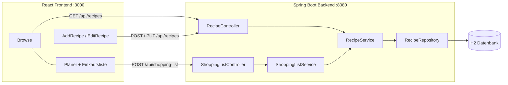

# M450 Projekt – Recipe Planner: Wochenplaner mit Einkaufsliste

Basis ist der Recipe Planner aus [KN06](../KN06/LOESUNG.md) und [KN07](../KN07/LOESUNG.md) (Spring Boot Backend + React Frontend).
Im Projekt kam ein neues Feature dazu, das komplett testgetrieben entwickelt wurde:

**Wochenplaner mit Einkaufsliste:** Man wählt, welche Rezepte man diese Woche wie oft kochen will, und bekommt eine
zusammengerechnete Einkaufsliste. Gleiche Zutaten mit gleicher Einheit werden addiert (`200 g Mehl` + `300 g Mehl` = `500 g Mehl`).

```bash
# Backend (Port 8080)
cd recipe-planner-backend
mvn spring-boot:run

# Frontend (Port 3000)
cd recipe-planner-frontend
npm install
npm start
```

| Was | Wo |
|---|---|
| Pipeline | [.github/workflows/projekt.yml](../.github/workflows/projekt.yml) |
| Testreports (GitHub Pages) | https://busydenis.github.io/M450_Denis/projekt/ |
| Pull Requests | [PRs auf GitHub](https://github.com/BusyDenis/M450_Denis/pulls?q=is%3Apr) |

---

## Planung

Kurze Planung ohne Gantt, Zeit war knapp, deshalb ein bestehendes Projekt erweitert statt ein neues angefangen.

| # | Schritt | Ergebnis |
|---|---|---|
| 1 | Scope festlegen | Ein Feature (Einkaufsliste), dafür sauber getestet statt viele Features mit wenig Tests |
| 2 | Basis übernehmen | Recipe Planner aus KN07 inkl. Add/Edit-Feature und bestehenden Tests |
| 3 | Backend mit TDD | `ShoppingListService` Red → Green → Refactor, danach Controller- und Integrationstest |
| 4 | Frontend | Seite *Planer* mit Einkaufsliste, Komponententests mit gemocktem axios |
| 5 | Pipeline | Build → Test → Deploy der Reports auf GitHub Pages |
| 6 | Code Reviews | Jedes Feature in eigenem Branch und Pull Request |
| 7 | Doku, Reflexion, Video | dieses README + Präsentation |

## Architektur



Der `ShoppingListService` hängt nur am `RecipeService`. Genau diese Schnittstelle wird im Unit Test mit Mockito weggemockt.

## Teststrategie

**Was wird getestet?** Die Business-Logik (Einkaufsliste zusammenrechnen, Rezepte speichern/ändern), die REST-Schnittstellen und
die React-Komponenten. Nicht getestet: Bootstrap-Styling und die Spring-Konfiguration selbst.

**Wie wird getestet?** Nach der Testpyramide: viele schnelle Unit Tests, weniger Integrationstests.

| Level | Was | Tools | Was wird gemockt |
|---|---|---|---|
| Unit | `ShoppingListService`, `RecipeService`, Mapper | JUnit 5, AssertJ, Mockito | `RecipeService` bzw. `RecipeRepository` |
| Komponente (Backend) | Controller, HTTP-Status, JSON | MockMvc, `@MockBean` | Service-Schicht |
| Integration | Controller → Service → Repository → H2 | `@SpringBootTest`, echte H2-DB | nichts |
| Komponente (Frontend) | `Planer`, `AddRecipe`, `EditRecipe`, `RecipeForm`, `formatUnit` | Jest, React Testing Library | `axios` (Backend) |

**Wo wird getestet?** Lokal in der IDE / mit `mvn test` und `npm test`, und automatisch in der Pipeline bei jedem Push und Pull Request.
Auf `main` werden die Reports danach auf GitHub Pages veröffentlicht.

**TDD:** Die Einkaufsliste (`ShoppingListService`) und `formatUnit` im Frontend wurden testgetrieben entwickelt.
Die Commits zeigen die Phasen: *Tests geschrieben (rot)* → *implementiert (grün)* → *refactored*.

## Testkonzept

| | |
|---|---|
| **Testobjekt** | Recipe Planner, Feature Einkaufsliste (Backend + Frontend) |
| **Testziel** | Die Einkaufsliste rechnet immer richtig, Fehler (unbekanntes Rezept, Backend down) werden sauber behandelt |
| **Testumgebung** | Java 21, Maven, H2 In-Memory; Node 20, Jest; GitHub Actions (`ubuntu-latest`) |
| **Endekriterium** | Alle Tests grün in der Pipeline, neue Klassen mit hoher Coverage |
| **Reports** | Surefire (HTML), JaCoCo (Coverage), Jest Coverage (Istanbul), Testresultate direkt als Check im PR |

### Testfälle Einkaufsliste

| ID | Testfall | Erwartet |
|---|---|---|
| T1 | Keine Rezepte geplant | leere Liste |
| T2 | Ein Rezept | genau seine Zutaten |
| T3 | Zwei Rezepte mit gleicher Zutat und Einheit | Mengen werden addiert |
| T4 | Gleiche Zutat, andere Einheit (g / kg) | zwei separate Einträge |
| T5 | `Mehl` und ` mehl ` | gleiche Zutat (Gross/Klein und Leerzeichen egal) |
| T6 | Rezept zweimal geplant | Mengen zählen doppelt |
| T7 | Unbekannte Rezept-ID | 404 / `ResourceNotFoundException` |
| T8 | Sortierung | alphabetisch nach Zutat |
| T9 | Frontend: nichts geplant | Button deaktiviert |
| T10 | Frontend: Backend-Fehler | Fehlermeldung wird angezeigt |

## Pipeline und Reports

[.github/workflows/projekt.yml](../.github/workflows/projekt.yml), läuft bei Push und Pull Request auf `Projekt/**`.

| Stage | Job | Was passiert |
|---|---|---|
| Build | `build` | Backend `mvn compile`, Frontend `npm ci` + `npm run build` |
| Test | `test-backend` | `mvn test`, Resultate als Check *Backend Tests*, Surefire + JaCoCo als Artefakt |
| Test | `test-frontend` | `npm run test:ci` (Jest mit Coverage + jest-junit), Check *Frontend Tests*, Coverage als Artefakt |
| Deploy | `deploy-reports` | nur auf `main`: alle Reports auf GitHub Pages unter `/projekt/` |

## Code Reviews

Jedes Feature hat einen eigenen Branch und einen Pull Request, gemerged wird erst, wenn die Pipeline grün ist.
Die Pull Requests aus KN07 (Rezept hinzufügen, Rezept bearbeiten Backend/Frontend) gehören zur Basis des Projekts,
dazu kommen die Projekt-PRs für die Einkaufsliste (Backend, Frontend) und Pipeline/Doku.

## KI-Nutzung

| Teil | KI-Einsatz |
|---|---|
| Code (Backend und Frontend) | teilweise mit KI erstellt |
| Tests | teilweise mit KI erstellt |
| Präsentation | mit KI erstellt |

Den Scope, die Testfälle der Einkaufsliste und die Reihenfolge Red → Green → Refactor habe ich vorgegeben.
Den Code habe ich gelesen und lokal laufen lassen, und ich kann ihn erklären.

## Reflexion

**TDD:** Weil die Tests zuerst da waren, musste ich mir vorher überlegen, was „gleiche Zutat“ eigentlich heisst:
gleicher Name **und** gleiche Einheit, Gross/Klein egal. Diese Regeln stehen jetzt als Testfälle im Code und nicht nur im Kopf.
Beim Refactoring konnte ich den Code umbauen, ohne Angst etwas kaputt zu machen, weil die Tests sofort rot geworden wären.
Für Logik wie die Einkaufsliste passt TDD sehr gut, für UI-Layout lohnt es sich weniger.

**Code Reviews:** Im Review aus KN07 hat Moreno Sachen gefunden, die mir selbst nicht aufgefallen sind (z.B. `GRAMM` statt `GRAM`,
doppeltes Absenden des Formulars). Kleine Pull Requests sind viel einfacher zu reviewen als ein grosser.
Wichtig ist, dass das Review konkret ist („Zeile 14: …“) und nicht nur „sieht gut aus“.

## Fazit

Mit einem kleinen Scope konnte das Feature sauber auf allen Testebenen abgedeckt werden. Die Pipeline führt alle Tests automatisch aus
und die Reports sind ohne lokales Setup online einsehbar.
